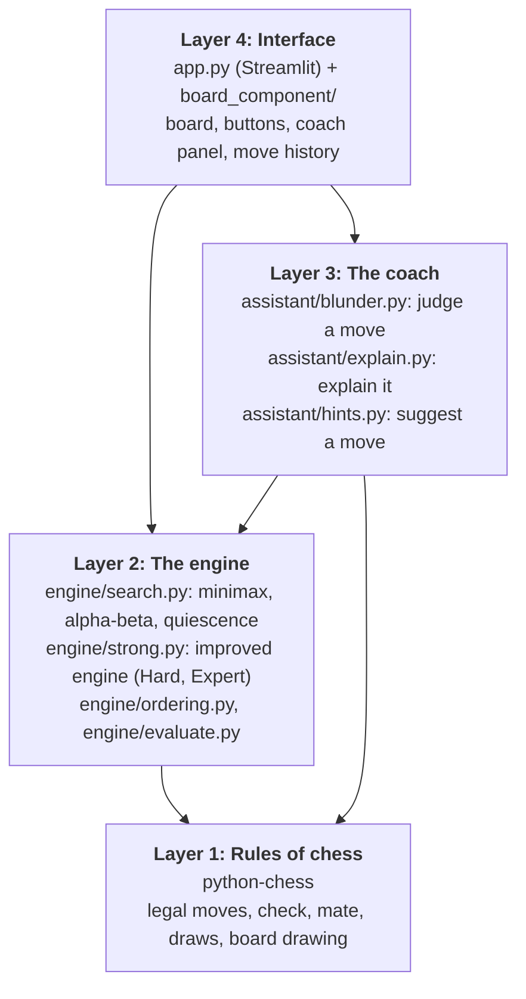
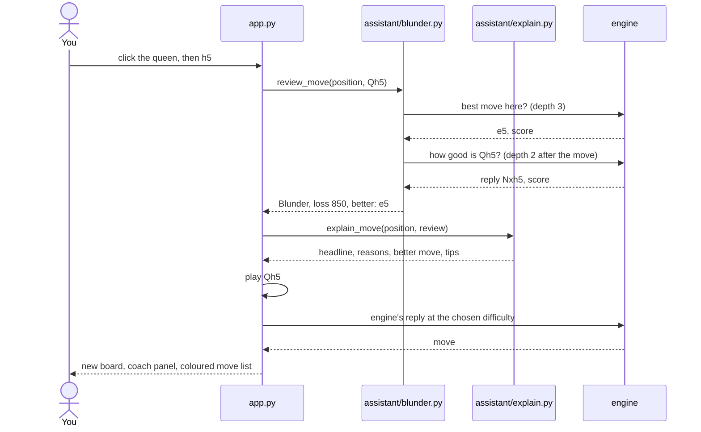

# Project Journal: AI Chess Assistant for Beginners

This is our working journal for the project. The first half explains how everything fits together and why we built it the way we did. The second half is the actual development log: what we built in each phase, what broke, and how we fixed it. We kept it mostly so we could explain any part of the project when asked, without having to dig through the code.

Live app: https://chessassist.streamlit.app/

---

## 1. The Idea

You play chess against the computer in the browser. After every move you make, a coach:

1. Labels the move: **Best, Good, Inaccuracy, Mistake or Blunder**.
2. If it was bad, explains **why**, in normal English ("This move walks into checkmate: your opponent plays Qh4#").
3. Shows what you **should have played**, on a small board with arrows, plus the reason it's better.
4. Gives opening tips when you do beginner things (queen out too early, knight on the edge, giving up castling).

You can also ask for a hint, take a move back, and pick how strong the opponent is.

All of the AI (search, evaluation, judging moves, explanations) is our own code. `python-chess` only gives us the rules.

---

## 2. How It's Put Together

### 2.1 Four layers



Keeping these separate paid off more than once:
- The engine has no idea there's a UI, so the exact same code runs in the app, in the tests and in the benchmarks.
- The coach doesn't have its own chess logic. To judge a move it just asks the engine two questions (section 4.4).
- We can test each layer on its own. The engine tests never open a browser.

### 2.2 Files

```
app.py                    Layer 4: the Streamlit app
board_component/          Layer 4: the click-to-move board (HTML + JavaScript)
benchmark_live.py         watch the engine play Stockfish in the browser
assistant/                Layer 3
  blunder.py              MoveReview: centipawn loss -> Best..Blunder
  explain.py              rule-based expert system -> sentences
  hints.py                best move + the idea behind it
engine/                   Layer 2
  evaluate.py             evaluate() and evaluate_advanced()
  search.py               minimax, alpha-beta, quiescence, find_best_move()
  strong.py               improved engine, search_best_move()
  ordering.py             MVV-LVA move ordering
tests/
  test_engine.py          12 engine tests
  test_assistant.py       13 coach tests
  compare_search.py       minimax vs alpha-beta experiment
  benchmark.py            our engine vs Stockfish (Phase 4)
  engine_match.py         engine vs engine / vs Stockfish matches (Phase 5)
  make_charts.py          charts for the report
docs/
  formulation.md          problem formulation
  JOURNAL.md              this file
  REPORT.md               final report
  DEMO.md                 demo script
  results/                every CSV, table and chart
```

### 2.3 What happens when you play a move



### 2.4 The main data structures

| Name | Where | What's in it |
|---|---|---|
| `chess.Board` | python-chess | A full position plus move history. `push(move)` plays, `pop()` undoes |
| `SearchResult` | `engine/search.py` | The engine's answer: `move`, `score`, `depth`, `nodes`, `seconds`, `algorithm` |
| `MoveReview` | `assistant/blunder.py` | The coach's verdict: `label`, `loss`, `best_move`, scores, the opponent's `reply` |
| `Feedback` | `assistant/explain.py` | The coach's words: `headline`, `reasons`, `better`, `tips` |
| `Hint` | `assistant/hints.py` | Suggested `move`, its `idea` in words, `score` |
| `st.session_state` | `app.py` | Everything that has to survive a page rerun: board, colour, reviews, feedback, hint |

One convention everywhere: scores are in **centipawns** (100 = one pawn) from **White's point of view**. Positive is good for White. Checkmate is around ±100,000.

---

## 3. Why We Didn't Write the Rules Ourselves

Generating legal chess moves properly (castling, en passant, promotion, pins, discovered checks) is a lot of fiddly work and has nothing to do with AI. So `python-chess` is our environment, the same way a robotics project uses a physics simulator, and our code is the agent. We use `Board`, `legal_moves`, `push`/`pop`, `is_checkmate`, `is_capture`, `attackers`, `san` (move names like Nf3) and `chess.svg`.

---

## 4. Module by Module

### 4.1 `engine/evaluate.py`: judging a position

When the search hits its depth limit it can't look further, so it needs a guess at how good the position is:

```
EVAL = sum over White pieces (piece value + square bonus)
     - sum over Black pieces (piece value + square bonus)
```

**Material:** pawn 100, knight 320, bishop 330, rook 500, queen 900. The bishop is a touch above the knight because it tends to be better in open positions.

**Piece-square tables:** every piece type has 64 numbers, one per square, which turn chess principles into points:

| Principle | How the table encodes it |
|---|---|
| Knights belong in the center | center +20, corners -50 |
| Center pawns are strong | e4, d4 +20 |
| Advanced pawns are close to promoting | 7th rank +50 |
| Rooks like the 7th rank | +10 |
| Hide the king in the middlegame | castled squares +30, center -50 |
| Use the king in the endgame | separate endgame table, center +40 |

The values come from Michniewski's *Simplified Evaluation Function*.

**The indexing detail everyone gets confused by:** python-chess numbers squares from a1 = 0 to h8 = 63, starting at rank 1, but the tables are written like a printed board starting at rank 8. So White pieces look up `chess.square_mirror(square)`, and Black pieces use the square number as-is, which already gives Black's mirror image.

**Sanity checks:** the starting position scores exactly 0, and mirroring any position (swapping colours) exactly flips the sign. Both are tested.

**`evaluate_advanced()`** is the richer version used by the improved engine. It's described in 4.9.

### 4.2 `engine/search.py`: looking ahead

#### Minimax

White is MAX, Black is MIN, and both are assumed to play their best:

```
                 White to move (MAX)
              /          |          \
          move A       move B       move C
         Black MIN    Black MIN    Black MIN
         /     \       /     \      /     \
       +3      +5    -2      +9   +1      +4
        \     /        \     /      \     /
       min = +3       min = -2     min = +1
              \          |          /
               max(+3, -2, +1) = +3   ->  play move A
```

Move B looks tempting because of the +9, but Black would just play into the -2. Minimax never hopes for a mistake.

The catch is that it looks at everything. About 35 moves per position means roughly 35^d positions: 1,225 at depth 2, 42,875 at depth 3, 1.5 million at depth 4.

#### Alpha-beta pruning

Same answer, much less work. Two numbers get passed down the tree:
- **alpha**: the best White is already guaranteed somewhere else
- **beta**: the best Black is already guaranteed somewhere else

In the tree above: after move A, White knows it can get +3 (alpha = 3). In move B, Black's first reply already gives -2. Black can force -2 there, which is worse for White than the +3 in hand, so White will never go into move B, and we never need to look at the +9. That skip is the prune (`if alpha >= beta: break`).

Alpha-beta never changes the answer, only the amount of work. `test_minimax_and_alphabeta_agree` checks this on four positions at depths 1 to 3.

#### Mate distance

Checkmate is scored `MATE_SCORE - ply` (ply = half-moves from the root), so mate in 1 is worth more than mate in 3. The engine goes for the fastest mate when winning and drags it out when losing.

#### Quiescence search

The horizon effect: at depth 2 the engine might see "my queen takes a pawn", stop there, and think it won a pawn, because the recapture is one move past its horizon. So at depth 0 we keep searching captures only, until things go quiet. "Stand pat" means the side to move can also just not capture, so the static evaluation is a floor (for White) or ceiling (for Black). We cap it at 8 extra plies.

#### `find_best_move()`

Tries every legal move at the root, scores each with minimax or alpha-beta, returns the best one plus stats. It works on a copy of the board so it never messes up the real game (tested).

### 4.3 `engine/ordering.py`: good moves first

Alpha-beta prunes most when the best move is tried first. We can't know it in advance, so we guess:
1. Captures, by **MVV-LVA** (Most Valuable Victim, Least Valuable Attacker): `10 x victim - attacker`, so pawn takes queen (8,900) goes before queen takes pawn (100)
2. Promotions
3. Checks
4. Everything else

At depth 4 this alone cut the nodes by 89.2%.

### 4.4 `assistant/blunder.py`: judging your move

The coach asks the engine:
1. "What's the best move here and what's it worth?" (`find_best_move(position, depth 3)`)
2. "What's the move you played worth?" (play it, then `find_best_move(new position, depth 2)`; one half-move is already played, so this covers exactly the same part of the tree)

```
centipawn loss = score(best move) - score(your move)    (from your side)
```

| Loss | Label | Symbol |
|---|---|---|
| 0, or the engine's own move | Best | ! |
| under 50 | Good | |
| 50 to 99 | Inaccuracy | ?! |
| 100 to 199 | Mistake | ? |
| 200 or more | Blunder | ?? |

One subtle bug we had to handle: question 2 starts one half-move later, so a mate it finds is counted one ply "closer". Without fixing that, playing the engine's own mating move showed a loss of 1. `_one_ply_later()` shifts mate scores by one ply.

The coach always uses depth 3 with the basic, exact search, whatever difficulty you're playing on, so your moves are judged the same way every time.

### 4.5 `assistant/explain.py`: the expert system

The engine decides *if* a move is bad. These rules work out *why*. They only run on moves already labelled Inaccuracy or worse, so they can't invent problems with good moves.

| Rule | Fires when | Example |
|---|---|---|
| Walking into mate | your move lets the opponent mate | "This move walks into checkmate: your opponent plays Qh4#." |
| Missed mate | the best move mated, yours didn't | "You missed a checkmate in one move, starting with Ra8#." |
| Moved piece hangs | the reply takes the piece you just moved | "You moved your bishop to a6, where it is undefended and can be captured for free." |
| Defender moved away | the reply takes a piece that was safe before | "Your pawn on e5 is no longer protected after this move." |
| Other material loss | the reply wins something else | "Your opponent can now win your knight on f3 with ..." |
| Hanging piece | something is attacked and undefended, or attacked by a cheaper piece | "Your rook on e5 can be taken by their pawn, a less valuable piece." |
| Missed free capture | the best move took an undefended piece | "You missed a free queen on d5 (Nxd5)." |
| Opening tips | first 10 moves | early queen, losing castling rights, knight on the rim |

`describe_move_idea()` does the opposite: it explains what a *good* move achieves (mates, wins material, promotes, castles, saves a piece, gives check, stops a mate threat, protects a piece, develops, takes the center). It's used for "Better was ..." and for hints.

**Spotting threats with a null move:** to find out what the opponent is threatening, we let the side to move "pass" (illegal in real chess, but a standard engine trick) and check if the opponent would then have mate in one. If your move removes that, the coach says so: "g6 stops your opponent's checkmate threat (Qxf7#)."

**Why rules and not ML?** We didn't want a teaching tool that can be confidently wrong. Every sentence comes from one rule and one fact you can check on the board. A neural net would need a big labelled dataset of explanations (which doesn't exist for free) and could still make things up.

### 4.6 `assistant/hints.py`

Runs the engine at the coach's depth and wraps the best move with `describe_move_idea()`: "Try Nxd5: it wins their queen for free." The app draws it as a green arrow.

### 4.7 `app.py`

Streamlit reruns the whole script from the top on every click, so anything that needs to survive (board, reviews, feedback) lives in `st.session_state`.

| Level | Engine | Behaviour |
|---|---|---|
| Easy | basic engine, depth 1, no quiescence | Greedy. Grabs material even when it gets recaptured, so a beginner can punish it |
| Medium | basic engine, depth 2 | Sees direct threats |
| Hard | improved engine, 0.5 s per move, at least depth 3 | Usually depth 3 to 5 |
| Expert | improved engine, 2 s per move, at least depth 4 | Usually depth 4 to 8 |

Take back removes your move and the engine's reply, including their reviews, so you can retry after a blunder.

### 4.8 `board_component/index.html`: the clickable board

Streamlit doesn't have a clickable chessboard, so we wrote a small custom component in plain HTML and JavaScript (no build step, no npm). Python sends it the position, the list of legal moves, the last move, the check square, any arrows, and the piece pictures (taken from python-chess so they match the other boards). The board draws all that, shows dots on the squares the selected piece can reach, and sends back the move you clicked. Python checks the move is legal again before playing it, so the board itself knows no chess rules at all.

### 4.9 `engine/strong.py` and `evaluate_advanced()`: the improved engine

The basic engine is correct but shallow: in the time it gets, it sees 3 or 4 half-moves. So in Phase 5 we added the standard techniques real engines use on top of alpha-beta. What uses which engine:

| Part of the app | Engine | Why |
|---|---|---|
| Easy, Medium | basic, depth 1 or 2 | meant to be beatable |
| Hard, Expert | improved | meant to be strong |
| Coach and hints | basic, exact depth 3 | the coach compares two searches, and those only agree reliably if both are exact |
| `compare_search.py` and the report tables | basic `minimax()` / `alphabeta()` | left untouched so the Phase 2 numbers still reproduce |

**Negamax.** The improved search is alpha-beta in negamax form. Since min(a, b) = -max(-a, -b), if every score is from the side to move's point of view, one branch does the job of minimax's two: my best score is the max of minus my opponent's best. Same algorithm, half the code, which matters once every node is doing several extra things.

**Iterative deepening with a time limit.** Search depth 1, then 2, then 3, until time runs out, and play the best move from the deepest search that finished. It sounds wasteful, but each depth costs several times more than the last, so the repeats are cheap, and each pass tells the next one which move to try first. Testing showed we needed two extra rules (see the Phase 5 log): a **minimum depth** that always finishes (3 on Hard, 4 on Expert), and **keeping the partial result** when time runs out mid-depth (the previous best move is searched first, so anything that already beat it is proven better).

**Transposition table.** The same position often comes up through different move orders (1.e4 e5 2.Nf3 and 1.Nf3 e5 2.e4). A dictionary keyed by position stores depth, score and best move so we don't search it twice. Scores are stored with a flag (exact / at least / at most) because alpha-beta often only proves a bound.

**Move ordering.** Transposition-table move first, then captures (MVV-LVA), promotions, **killer moves** (quiet moves that caused a cut-off in a sibling position), then quiet moves by **history score** (how often that from-to move caused cut-offs anywhere).

**Null-move pruning.** Pass and let the opponent move twice. If we're still above beta, a real move would be even better, so we cut the line after a shallow search. Not used in check, or with only king and pawns, because of zugzwang (positions where passing would actually be better than any real move). Same null-move trick the coach uses for threats.

**Principal variation search and late move reductions.** After the first (probably best) move, the rest only get a cheap yes/no test: "is this better than alpha?" Quiet moves late in the list get searched one ply shallower first, and only get a full search if they surprise us.

**Check extension.** One ply deeper when in check, because checks are forcing and that's where short tactics hide.

**Repetition on the first repeat.** The basic search only noticed *threefold* repetitions, so it happily walked into repeated positions and drew won games (16 of our 17 Phase 4 draws). Now any position already seen in the game or on the search path counts as a draw, so a winning engine avoids it.

**`evaluate_advanced()`** adds to the basic evaluation:
- *Tapered evaluation*: a middlegame score and an endgame score blended by game phase (24 with all pieces on, 0 with just kings and pawns), instead of a sudden switch.
- *Pawn structure*: passed pawns (bigger bonus the further they've gone, doubled in the endgame), doubled pawns -15, isolated pawns -15.
- *Pieces*: bishop pair +30, rook on an open file +20, half-open +10.
- *King shelter*: +10 per pawn in front of the king, middlegame only.
- *Mop-up*: when a side is a rook or more ahead, reward pushing the enemy king to the edge and bringing our king closer, so it can actually finish the game. Tested: king and queen against king ends in mate.
- *Speed*: profiling showed evaluation was 70% of the search time. Reading pieces straight from bitmasks, precomputing value + square tables, and caching pawn-structure scores by pawn layout (a pawn hash table) made the search about 1.7x faster.

---

## 5. Testing

| File | What it covers |
|---|---|
| `tests/test_engine.py` (12 tests) | Start position scores 0; evaluations are colour-symmetric; alpha-beta gives the same score as minimax; mate in 1 for both colours; mate in 2; takes a free queen; refuses a poisoned pawn; doesn't modify the caller's board; the improved engine passes the same tactics and mates with king and queen vs king |
| `tests/test_assistant.py` (13 tests) | Hanging bishop is a Blunder with the right square named; missed free queen; Fool's Mate caught with "Qh4#"; missed mate; mating move praised as Best; early queen tip; knight on the rim; e4 gets no complaints; Black's moves reviewed too; Scholar's Mate defence explained; "no longer protected" rule; hints find the free queen and the mate |
| `tests/compare_search.py` | Node counts and times: minimax vs alpha-beta vs alpha-beta + ordering |
| `tests/benchmark.py` | 90 games vs Stockfish 16 at skill 0 to 2 |
| `tests/engine_match.py` | Matches between any two engines (old, new, new search with old eval, Stockfish), 10 openings x both colours |
| `tests/make_charts.py` | The PNG charts in the report |
| `benchmark_live.py` | Not a test: watch our engine play Stockfish in the browser |

We also tested the app headlessly with Streamlit's `AppTest` (play, hint, take back, difficulty changes, the improved engine on Hard) and by actually clicking through it in a browser.

---

## 6. Results

### Search efficiency (Phase 2)

Total positions searched over four test positions (start, Italian, middlegame, endgame), quiescence off so every variant searches the same tree:

| Depth | Minimax | Alpha-beta | Alpha-beta + ordering | Saving vs minimax |
|---|---|---|---|---|
| 2 | 3,627 | 1,320 | 461 | **87.3%** |
| 3 | 117,954 | 15,895 | 4,296 | **96.4%** |
| 4 | not run (takes minutes) | 182,963 | 19,722 | ordering alone: **89.2%** |

Same scores every time. Full table in `docs/results/search_comparison.md`.

### Speed (Phase 3)

| What | Typical time |
|---|---|
| Engine move, depth 3 | 0.06 to 0.8 s |
| Engine move, depth 4 | 0.06 to 2.3 s |
| Coach reviewing one move | 0.02 to 1.1 s |

### Playing strength (Phase 4)

90 games against Stockfish 16 at skill 0 to 2 (out of 20), 10 per pairing (5 openings x both colours). Score = wins + half the draws.

| Our depth | vs Skill 0 | vs Skill 1 | vs Skill 2 | Total | W / D / L |
|---|---|---|---|---|---|
| 2 | 45% | 35% | 20% | **33%** | 7 / 6 / 17 |
| 3 | 70% | 60% | 65% | **65%** | 17 / 5 / 8 |
| 4 | 80% | 90% | 70% | **80%** | 21 / 6 / 3 |

Charts: `docs/results/chart_nodes.png`, `chart_time.png`, `chart_benchmark.png`.

### Playing strength after the improvements (Phase 5)

20 games per match (10 openings x both colours), Stockfish 19 at 0.05 s per move. Every game is in `docs/results/match_*.csv`.

**Head to head** (Hard settings: new engine 0.5 s per move, old engine depth 3)

| Match | W / D / L | Score | Elo difference |
|---|---|---|---|
| New engine vs old engine | 13 / 4 / 3 | **75%** | about +190 |
| New search + old evaluation vs old engine | 15 / 5 / 0 | 88% | about +340 |
| New evaluation vs old evaluation (same new search) | 15 / 2 / 3 | **80%** | about +240 |

**Against Stockfish 19**

| Level | Engine | vs Skill 2 | vs Skill 4 | vs Skill 6 |
|---|---|---|---|---|
| Hard | old (depth 3) | 40% | 30% | 15% |
| Hard | new, first version (0.5 s) | 72% | 20% | 12% |
| Hard | **new, final (0.5 s, min depth 3)** | not re-run | **42%** | **20%** |
| Expert | old (depth 4) | | | 12% |
| Expert | **new, final (2 s, min depth 4)** | | | **42%** |

What we take from this:
- Expert improved the most: 12% (1 win in 20) to 42% (5 wins, 7 draws) against skill 6, roughly +285 Elo.
- Hard only came out ahead once we fixed the time management (see the Phase 5 log). The first version actually looked worse against skill 4 and 6.
- 20 games per match means each score is only good to about ±10 points. What makes us trust the results is that every comparison points the same way, not any single number.
- These can't be compared directly with the Phase 4 table (different Stockfish version, openings and skill levels).

---

## 7. Development Log

Phases 1 to 4 were built on 9 and 10 October 2026, each on its own branch. The click-to-move board and Phase 5 followed on 11 October.

### Phase 1: Formulation and board

**Built**
- `docs/formulation.md`: state, actions, transition model, terminal test, utility, PEAS, environment properties, knowledge types, why AI is needed, and the techniques we picked and rejected (MCTS, reinforcement learning, just using Stockfish).
- A first `app.py`: playable board against a random-move opponent, full rules, play as White or Black, move list.

**Problems**
- python-chess wouldn't install on the system Python (a setuptools `install_layout` error). A virtual environment with up-to-date pip and setuptools fixed it, which is why the README starts with a venv.
- Streamlit has no clickable chessboard, so the first version picked moves from a dropdown of legal moves. Reliable, and illegal moves were impossible, but it felt nothing like chess.

### Phase 2: The engine

**Built**
- Evaluation (material + piece-square tables, separate endgame king table).
- Minimax, alpha-beta, quiescence, mate-distance scoring, node counting.
- MVV-LVA ordering.
- Engine hooked into the app with a depth setting and evaluation / nodes / time display.
- 9 tests and the minimax vs alpha-beta experiment.

**Problems**
- The mate-in-2 test failed twice, and both times the test was wrong, not the engine. First the position actually had a mate in 1 (the engine found it; the test expected 2). Then the fixed position had a rook on f1 that couldn't reach e8. We switched to doubled rooks on the e-file, and the test now checks there's no mate in 1 first. Lesson: test your tests.
- The dropdown defaulted to the alphabetically first move (Na3), so clicking Play without choosing played a random-looking move. The selector now starts empty and Play stays disabled until you pick.
- Plain minimax at depth 4 takes minutes in Python, so the experiment only runs minimax up to depth 3 and says so. Honestly, that's the best argument for pruning there is.

### Phase 3: The coach

**Built**
- `blunder.py`: move review by centipawn loss, five labels with chess symbols, mate-distance correction.
- `explain.py`: the explanation rules, opening tips, `describe_move_idea()`, null-move threat detection.
- `hints.py`: hints with the reason behind them.
- App: difficulty levels, coach toggle, coach panel with coloured badge, a "position before your move" board with red and green arrows, hint arrow, take back, annotated move history and a summary.
- 13 coach tests.

**Problems**
- *Filler explanations.* For inaccuracies the coach said things like "Your opponent's strongest reply is Nc6", which teaches nothing. That line now only appears for mistakes and blunders.
- *Misleading wording.* After ...Nd4 it said "your pawn on e5 is undefended", when the real lesson was that the knight *had been* defending it. We added a rule that compares before and after: "is no longer protected after this move".
- *Vague praise.* The right defence to the Scholar's Mate threat, ...g6, was described as "improves your position". Adding null-move threat detection made it "stops your opponent's checkmate threat (Qxf7#)". That also improved the "Better was ..." line for the blunder ...Nf6??.
- A test used an illegal move (h3 with no h-pawn). Replaced with Kf2.
- The summary badges wrapped badly, with the count falling onto the next line, so the count now sits inside each badge.

### Phase 4: Benchmark and report

**Built**
- `tests/benchmark.py`: our engine vs Stockfish 16 at skill 0, 1, 2, at depths 2, 3 and 4 (same settings as Medium, Hard, Expert at the time). 10 games per pairing, 90 total, every move list saved.
- `tests/make_charts.py`: the three report charts, colour-blind checked.
- `docs/REPORT.md` and `docs/DEMO.md`.

**Why we set it up this way**
- *5 openings x 2 colours:* our engine is deterministic, so without different starts many games would be exact repeats. Playing both colours also cancels out White's first-move advantage.
- *Stockfish's lowest skill levels:* at full strength it wins every game and we learn nothing.
- *200 half-move cap:* neither side had an endgame plan, so some games would shuffle forever. Capped games count as draws.

**Problems**
- Stockfish wasn't available at first; the package lists needed an `apt-get update`.
- Depth 4 is slow (1 to 2 minutes per game), so the full benchmark takes 30 to 60 minutes. We split it across two processes and merged the results.
- The machine restarted 55 games into the 90. Because results were saved after every game, nothing was lost, and we added resume support so the same command just carries on. Long experiments should always be restartable.
- Two benchmark processes share the CPU, so the time-per-move numbers there are a bit high. The clean timings are the ones from `compare_search.py`.

**Result:** 33% / 65% / 80% at depths 2 / 3 / 4. 16 of the 17 draws were threefold repetitions, which became a Phase 5 target.

### The clickable board

The dropdown had to go. We wrote `board_component/index.html`, a Streamlit custom component in plain HTML and JavaScript (described in 4.8). Two bugs came up:
- We gave the board the widget key `"board"`, which quietly overwrote the game stored in `st.session_state.board`, and the app crashed with "dict has no attribute is_game_over". The key is now `"board_clicks"`.
- A component keeps returning its last value on every rerun, so after Take back, the same click would have been replayed. Each click now carries a unique id, and Python ignores ids it has already handled.

The app was then deployed for free on Streamlit Community Cloud: https://chessassist.streamlit.app/

### Phase 5: Making the engine stronger

**Built**
- `engine/strong.py` and `evaluate_advanced()` (section 4.9), used on Hard and Expert.
- `tests/engine_match.py`, which plays any two engines against each other in parallel.
- 3 more engine tests (12 total).
- `benchmark_live.py`, to watch games against Stockfish in the browser.
- Stockfish 19 installed with `winget install Stockfish.Stockfish`; `find_stockfish()` now also looks in winget's folder.

**Problems, and how we tracked them down**
1. *The first version was barely deeper than the old engine in middlegames.* A profiler showed evaluation was 70% of the time, mostly inside python-chess's `piece_map()`. Reading bitmasks directly, precomputing tables and caching pawn structure made it about 1.7x faster. Adding principal variation search and late move reductions then shrank the tree enough to reach depth 4 to 8 in 2 seconds.
2. *Was the new evaluation actually helping?* The new search with the old evaluation scored 88% against the old engine, better than the full new engine's 75%, which made it look like our evaluation was hurting. So we played them against each other directly: same search, new eval vs old eval. The new evaluation won 80% (+15 =2 -3). The earlier gap was just noise from small samples against a third engine. Lesson: compare two versions directly, and don't over-trust 20 games.
3. *Against Stockfish skill 4 and 6, new "Hard" was no better than old "Hard"*, even though it beat old Hard 75% head to head. That didn't add up, so we used full-strength Stockfish purely as an analysis tool (it never picks our moves) to find our engine's real blunders in the lost games: 42 of them. Then we replayed every one of those positions under different settings:

   | Setting | Blunders avoided (out of 42) |
   |---|---|
   | new engine, 0.5 s, as played | 4 |
   | null-move pruning off | 3 |
   | late move reductions off | 3 |
   | both off | 2 |
   | **new engine, 2 s** | **20** |
   | old engine, depth 3 | 15 |

   Turning pruning off didn't help at all, but more time did. So the problem was **time, not pruning**. In sharp middlegames the old depth-3 search takes about a second, so the "Hard vs Hard" comparison had quietly been giving the old engine more time than the new one's 0.5 s. On top of that, the new engine threw away any depth it hadn't finished. The fix was a minimum depth that always finishes (3 on Hard, 4 on Expert) and keeping the partial result of an unfinished depth.

   We also realised running 4 games at once was biasing things: a time-limited engine loses depth when it shares the CPU, while a fixed-depth engine just takes longer. Matches now run 3 at a time.

   **After the fix:** new Hard vs Stockfish skill 4 went from 20% to 42%, and Expert vs skill 6 from 12% to 42%.
4. *A 49-move loss turned out to be a horizon problem, not a bug.* The engine grabbed a pawn with Qxc2 and walked into a knight fork whose payoff was 5 to 6 half-moves away, just past what 0.5 seconds could see.

---

## 8. Design Decisions

| We chose | Over | Because |
|---|---|---|
| python-chess for the rules | writing move generation | rules aren't AI; it would have cost weeks and bugs |
| Explicit MAX/MIN minimax in the basic engine | negamax | matches the textbook, easier to explain on a whiteboard |
| Negamax in the improved engine | MAX/MIN | every node does several extra things now; writing them twice would double the code |
| Keeping alpha-beta separate from minimax | only alpha-beta | so we could measure the saving on identical trees |
| Improved engine in a new file | upgrading `alphabeta()` in place | the report's comparison and the coach's exact search keep working unchanged |
| Coach at a fixed depth 3, exact search | coach at the opponent's level | consistent judging; pruning tricks could make it blame good moves |
| Rule-based explanations | ML or a language model | correct, predictable, traceable, no training data needed |
| Time limit + minimum depth on Hard / Expert | fixed depth | predictable waiting time on any computer, deeper in simple positions |
| Easy / Medium on the basic engine | a weakened improved engine | the basic engine's mistakes are the human-looking ones a beginner can punish |
| Streamlit + a small custom board component | pygame | runs in a browser and deploys for free |
| Python | C++ | readability mattered more than speed for this project |

---

## 9. Limitations

1. **The coach only sees 3 half-moves ahead.** It calls the sound but aggressive 4.Ng5 in the Two Knights Defence an inaccuracy, because the attack pays off past its horizon.
2. **The evaluation is hand-tuned.** No mobility term yet, and the weights are textbook values, not tuned on games.
3. **Explanations only cover common patterns.** Forks, pins and skewers aren't named; the coach falls back to "your opponent can win your knight with ...".
4. **Python is slow.** About 25,000 positions per second, against millions for engines written in C. That's the main reason we can't get close to full-strength Stockfish.
5. **No opening book or endgame tablebases.** A lot of the improved engine's losses start with an early opening mistake.
6. **Pruning isn't exact.** Null-move pruning and late move reductions occasionally miss something a full search would see, which is why the coach stays on the exact search.
7. **Easy and Medium still use the basic engine**, including its old habit of shuffling in won endgames. That's deliberate.

---

## 10. Git

| Branch | Contains |
|---|---|
| `phase-1-formulation-board` | Phase 1 |
| `phase-2-engine` | Phases 1 and 2 |
| `phase-3-assistant` | Phases 1 to 3 |
| `phase-4-testing-report` | Phases 1 to 4 |
| `phase-5-engine-improvements` | The clickable board and Phase 5 |
| `main` | The latest finished work; Streamlit Cloud deploys from here |

Repo: https://github.com/astrilo-monk/ai-project-clg

---

## 11. Viva Prep

1. **Why adversarial search?** The opponent picks every other move and is trying to beat us, so we have to assume their best reply. Ordinary search like A* assumes we control every action.
2. **How does minimax work?** Search to a fixed depth, score the leaves with the evaluation, White takes the max, Black the min, play the move with the best backed-up value.
3. **What does alpha-beta cut, and why doesn't it change the result?** Once alpha >= beta at a node, the opponent already has something better elsewhere, so this line is never reached with best play. Skipping it can't change the answer. Our test checks this.
4. **Why does move ordering help?** Cut-offs happen as soon as a good enough move turns up. Captures first finds those early. 89.2% fewer nodes at depth 4.
5. **What's the evaluation function?** Material plus piece-square tables (basic). The advanced one adds the game phase, pawn structure, bishop pair, rook files, king shelter and mop-up.
6. **What's the horizon effect?** Misjudging a position because the refutation is just past the depth limit. Quiescence search keeps going with captures until things are quiet.
7. **How do you decide something's a blunder?** Centipawn loss at depth 3: 200+ blunder, 100 to 199 mistake, 50 to 99 inaccuracy.
8. **Why not just use Stockfish?** Then there'd be no AI of our own in the project. Stockfish is only a benchmark opponent and, in Phase 5, an analysis judge.
9. **Isn't iterative deepening wasteful?** Each depth costs several times the previous one, so the repeats add little, and each pass gives the next its best move to try first, which makes alpha-beta prune much more. And there's always a move ready.
10. **What's a transposition table?** A dictionary from positions to what we've already worked out (depth, score, exact or bound, best move), so a position reached by a different move order is only searched once.
11. **Null-move pruning?** Pass the turn. If we're still above beta, a real move would be too, so cut. Unsafe in zugzwang, so it's off with only king and pawns.
12. **Why doesn't the coach use the stronger engine?** Its pruning isn't exact, so the coach's two searches could disagree and it would blame good moves.
13. **Limitations and future work?** Section 9, plus: name tactics, add an opening book and tablebases, tune or learn the evaluation weights, review uploaded games.

Things worth being able to do without notes: run minimax and alpha-beta by hand on a small tree; explain `square_mirror`; compute a centipawn loss from two scores; walk through one explanation rule and the board fact it checks; explain negamax, iterative deepening and null-move pruning with a small example each.

---

## 12. Glossary

| Term | Meaning |
|---|---|
| Ply | One half-move. Depth 3 = 3 plies |
| Centipawn | 1/100 of a pawn, the unit of every score |
| Node | One position visited by the search |
| Heuristic | A rule of thumb that estimates rather than proves |
| Static evaluation | Scoring a position without looking ahead |
| Quiescence search | Searching captures past the depth limit until quiet |
| Horizon effect | Misjudging because the key move is just past the depth |
| MVV-LVA | Most Valuable Victim, Least Valuable Attacker |
| Negamax | Minimax with one branch, using min(a, b) = -max(-a, -b) |
| Transposition | The same position reached through a different move order |
| Null move | Passing the turn: illegal in chess, useful in search |
| Zugzwang | A position where every move makes things worse |
| Hanging piece | A piece that can be taken without fair compensation |
| Elo | Rating scale; a 75% score is roughly +190 |
| FEN / SAN | One-line position format / move notation like Nf3, exd5, Qh4# |
| Expert system | AI that reasons with hand-written if-then rules |

---

## 13. A Note on How This Was Built

We used an AI coding assistant (Claude) throughout the project, for writing code, running experiments and drafting documentation. The commits from Phases 1 to 4 carry a co-author line that says so. The problems in the development log are real ones we hit along the way. If anyone asks, the honest answer is yes, and the way we show the understanding is ours is by explaining any part of it on a whiteboard.
