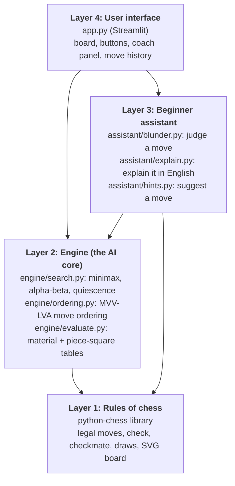
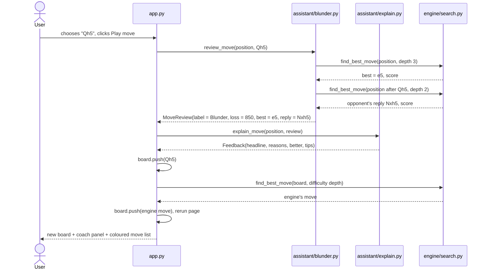

# Project Journal: AI Chess Assistant for Beginner Players

This journal explains how the whole system is built and why, and records what happened in each phase: what was built, what went wrong, and how it was fixed. Read it before every progress meeting.

**How to use this file**
- Sections 1 to 4 explain the **architecture** (the big picture, then each module in detail).
- Sections 5 and 6 cover **testing and results**.
- Section 7 is the **phase-by-phase development log**.
- Sections 8 to 12 cover **decisions, limitations, git workflow, viva answers and a glossary**.

---

## 1. What the System Does

The user plays chess against an AI opponent in a web browser. After every move the user makes, an AI **coach**:

1. Judges the move: **Best, Good, Inaccuracy, Mistake or Blunder**.
2. Explains in plain English **why** a bad move is bad (for example "This move walks into checkmate: your opponent plays Qh4#").
3. Shows the **better move**, with the reason it is better, on a small board with arrows.
4. Gives **opening tips** (early queen moves, giving up castling, knights on the edge).

The user can also ask for a **hint** (best move plus the reason), **take back** a move to try again, and choose the opponent's **difficulty**.

All of the AI (search, evaluation, move judging, explanations) is written from scratch. The `python-chess` library supplies only the rules of chess.

---

## 2. Architecture Overview

### 2.1 Layers

The system has four layers. Each layer only uses the layer below it.



**Why layers?**
- **The engine knows nothing about the user interface.** The same engine runs in the app, in the tests, and in the benchmark scripts.
- **The assistant reuses the engine instead of duplicating it.** To judge a move, the coach simply asks the engine two questions (see section 4.5).
- **Each layer can be tested on its own.** The engine tests never open a browser, and the assistant tests never draw a board.
- **Layers can be swapped.** Replacing Streamlit with pygame would only change `app.py`.

### 2.2 Folder Map

```
chess-assistant/
├── app.py                    Layer 4: Streamlit web interface
├── assistant/                Layer 3: the teaching layer (Phase 3)
│   ├── blunder.py            MoveReview: centipawn loss and Best..Blunder label
│   ├── explain.py            Rule-based expert system, Feedback sentences
│   └── hints.py              Hint: best move plus its idea
├── engine/                   Layer 2: the AI core (Phase 2)
│   ├── evaluate.py           Heuristic evaluation function
│   ├── search.py             Minimax, alpha-beta, quiescence, find_best_move()
│   └── ordering.py           MVV-LVA move ordering
├── tests/
│   ├── test_engine.py        9 engine correctness tests
│   ├── test_assistant.py     13 coach tests
│   └── compare_search.py     Minimax vs alpha-beta experiment
├── docs/
│   ├── formulation.md        Phase 1 problem formulation
│   ├── JOURNAL.md            This file
│   └── results/              Experiment outputs (CSV + tables)
├── requirements.txt
└── README.md                 Build guide and progress table
```

### 2.3 What Happens When You Play a Move

This is the full journey of one click on **Play move**:



### 2.4 Key Data Structures

| Name | Defined in | What it holds |
|---|---|---|
| `chess.Board` | python-chess | A full position: pieces, side to move, castling rights, en passant, move history. `push(move)` plays a move, `pop()` undoes it |
| `SearchResult` | `engine/search.py` | The engine's answer: `move`, `score` (centipawns, White's view), `depth`, `nodes`, `seconds`, `algorithm` |
| `MoveReview` | `assistant/blunder.py` | The coach's verdict on one move: `label`, `loss`, `best_move`, `best_score`, `played_score`, opponent's `reply` |
| `Feedback` | `assistant/explain.py` | The coach's words: `headline`, `reasons` (why it was bad), `better` (what to play instead), `tips` |
| `Hint` | `assistant/hints.py` | Suggested `move`, its `idea` in words, and `score` |
| `st.session_state` | `app.py` | Everything that survives between clicks: `board`, `player_color`, `reviews`, `feedback`, `hint`, `last_search` |

**Scoring convention used everywhere:** scores are in **centipawns** (100 = one pawn) from **White's point of view**. Positive means White is better, negative means Black is better. Checkmate is scored around ±100000.

---

## 3. Layer 1: Rules (python-chess)

We do **not** write move generation ourselves. Generating legal chess moves (castling, en passant, promotion, pins, checks) is a large, error-prone task that has nothing to do with AI. `python-chess` is to this project what a physics simulator is to a robotics project: it is the **environment**, and our code is the **agent**.

What we use from it: `Board`, `legal_moves`, `push`/`pop`, `is_checkmate`, `is_capture`, `attackers`, `san` (move names like "Nf3"), and `chess.svg` to draw boards.

---

## 4. Module Deep Dives

### 4.1 `engine/evaluate.py`: How the AI Judges a Position

When the search reaches its depth limit, it cannot look further, so it needs an **estimate** of how good the position is. That estimate is the **heuristic evaluation function**:

```
EVAL(position) = sum over White pieces of (piece value + square bonus)
               - sum over Black pieces of (piece value + square bonus)
```

**Part 1: Material (declarative knowledge).** Pawn 100, Knight 320, Bishop 330, Rook 500, Queen 900. Bishops are slightly above knights because they usually become stronger in open positions.

**Part 2: Piece-square tables (heuristic knowledge).** Each piece type has a table of 64 bonuses, one per square. They encode chess principles as numbers:

| Principle | How the table encodes it |
|---|---|
| Knights belong in the center | Center squares +20, corners -50 |
| Pawns in the center are strong | e4 and d4 get +20 |
| Advanced pawns are close to promoting | 7th rank pawns get +50 |
| Rooks love the 7th rank | +10 on the 7th rank |
| King hides in the middlegame | Castled squares (g1, b1) get +30, center -50 |
| King fights in the endgame | A separate endgame table rewards the center (+40) |

**Indexing detail (often asked).** python-chess numbers squares a1 = 0 up to h8 = 63, starting from rank 1. Our tables are written like a printed board, starting from rank 8. So for a White piece we flip the rank with `chess.square_mirror(square)`. For a Black piece, the raw square number already gives the mirror image we need, because Black's tables are White's tables seen from the other side.

**Endgame detection.** It counts as an endgame when neither side has a queen, or when every side that does have a queen has at most one minor piece and no rooks. The king then switches to the endgame table.

**Sanity check.** The starting position evaluates to exactly 0, because it is symmetric. The tests also check that mirroring any position (swapping colours) exactly negates the score.

### 4.2 `engine/search.py`: How the AI Thinks Ahead

#### Minimax

Chess is a two-player zero-sum game. **White is MAX** (wants the highest score), **Black is MIN** (wants the lowest score). Minimax assumes both sides play their best:

```
                 White to move (MAX)
              /          |          \
          move A       move B       move C
         Black MIN    Black MIN    Black MIN
         /     \       /     \      /     \
       +3      +5    -2      +9   +1      +4
        \     /        \     /      \     /
       min = +3       min = -2     min = +1
              \          |          /
               max(+3, -2, +1) = +3   ->  play move A
```

Move B *looks* tempting because of the +9, but Black would answer with the -2 line. Minimax never hopes the opponent makes a mistake.

**Cost:** it visits every node. With about 35 legal moves per position, depth d costs about 35^d nodes: 1,225 at depth 2, 42,875 at depth 3, 1.5 million at depth 4.

#### Alpha-beta pruning

The same answer as minimax, with far less work. Two numbers travel down the tree:

- **alpha**: the best score White is already guaranteed somewhere else
- **beta**: the best score Black is already guaranteed somewhere else

Using the tree above: after move A we know White can get **+3** (alpha = 3). Now search move B. Black's first reply gives **-2**. Black can already force -2 here, which is worse for White than the +3 already in hand, so **White will never choose move B**. The +9 branch is never searched: that is the **prune**. In code: `if alpha >= beta: break`.

Alpha-beta never changes the result, it only skips branches that cannot matter. Our test `test_minimax_and_alphabeta_agree` proves this on four positions at depths 1, 2 and 3.

#### Terminal positions and mate distance

`terminal_score()` handles game-over positions. Checkmate is scored `MATE_SCORE - ply`, where `ply` counts half-moves from the root. A mate in 1 is therefore worth more than a mate in 3, so the engine plays the **fastest** mate when winning and delays mate as long as possible when losing.

#### Quiescence search (fixes the horizon effect)

**The horizon effect:** at depth 2 the engine might see "my queen takes a pawn" and stop there, believing it won a pawn, because the recapture of the queen is just beyond its horizon.

**The fix:** when depth reaches 0, keep searching **captures only** until the position is quiet. "Stand pat" means the side to move may decline to capture, so the static evaluation acts as a floor (for White) or ceiling (for Black). Captures are limited to 8 extra plies for safety.

#### `find_best_move()`: the entry point

It tries every legal move at the root, scores each with minimax or alpha-beta, and returns the best one together with statistics (nodes, time). It copies the board first, so the caller's game is never modified (also tested).

### 4.3 `engine/ordering.py`: Searching Good Moves First

Alpha-beta prunes the most when the best move is searched first. We cannot know the best move in advance, so we guess cheaply:

1. **Captures, by MVV-LVA** (Most Valuable Victim, Least Valuable Attacker). Score = 10 × victim value − attacker value, so pawn takes queen (8,900) comes before queen takes pawn (100).
2. **Promotions.**
3. **Checks.**
4. Everything else.

Measured effect at depth 4: **89.2% fewer nodes** than alpha-beta without ordering (section 6).

### 4.4 `assistant/blunder.py`: Judging the Player's Move

The coach asks the engine two questions:

1. **"What is the best move here, and what is it worth?"** `find_best_move(position, depth 3)`
2. **"What is the player's move worth?"** Play the move, then `find_best_move(new position, depth 2)`. One half-move has already been played, so this searches exactly the same part of the tree that question 1 searched for that move.

```
centipawn loss = score(best move) − score(played move)     (from the player's side)
```

| Loss | Label | Symbol |
|---|---|---|
| 0 (or same move as engine) | Best | ! |
| under 50 | Good | |
| 50 to 99 | Inaccuracy | ?! |
| 100 to 199 | Mistake | ? |
| 200 or more | Blunder | ?? |

The symbols are the standard annotation symbols used in chess books.

**A subtle detail.** Question 2 searches from one half-move later, so any mate it finds is counted one ply "closer" than question 1 would count it. Without correction, playing the engine's own mating move could show a loss of 1. `_one_ply_later()` shifts mate scores by one ply to fix this.

**Why the coach always uses depth 3:** the opponent's difficulty changes how well the opponent plays, but the user's moves should be judged by the same standard on every level.

### 4.5 `assistant/explain.py`: Explaining in English (Expert System)

This module is a **rule-based expert system**. The engine decides **if** a move is bad (numbers). The rules explain **why** (words). The rules only run on moves the engine already labelled Inaccuracy, Mistake or Blunder, so they never invent problems with good moves.

| Rule | Fires when | Example output |
|---|---|---|
| 1. Walking into mate | The played move's score is "opponent mates" | "This move walks into checkmate: your opponent plays Qh4#." |
| 2. Missed mate | The best move's score is "you mate", the played one is not | "You missed a checkmate in one move, starting with Ra8#." |
| 3a. Moved piece hangs | Opponent's best reply captures the piece you just moved | "You moved your bishop to a6, where it is undefended and can be captured for free. Your opponent can play Nxa6." |
| 3b. Defender moved away | Reply captures a piece that was safe before your move | "Your pawn on e5 is no longer protected after this move. Your opponent can play Nxe5." |
| 3c. Other material loss | Reply captures something else | "Your opponent can now win your knight on f3 with ..." |
| 4. Hanging piece | A piece is attacked and undefended, or attacked by a cheaper piece | "Your rook on e5 can be taken by their pawn, a less valuable piece." |
| 5. Missed free capture | Best move captured an undefended piece | "You missed a free queen on d5 (Nxd5)." |
| Tips | Opening principles, first 10 moves | Early queen, king move that loses castling, knight on the rim |

**`describe_move_idea()`** explains what a *good* move achieves, in priority order: delivers checkmate, wins material, promotes, castles, rescues a piece in danger, gives check, **stops a mate threat**, protects a piece, develops a piece, takes the center. It is used for "Better was ..." and for hints.

**Threat detection with a null move.** To find out what the opponent is threatening, we let the side to move "pass" (a null move, which is illegal in real chess but a standard engine technique) and check whether the opponent would then have a mate in one. If our move removes that, the explanation says so: "g6 stops your opponent's checkmate threat (Qxf7#)."

**Why rules and not machine learning?** A teaching tool must never explain wrongly. Every sentence here traces back to one rule and one verifiable fact about the board. A neural network would need a large labelled dataset of explanations (which does not exist for free) and could produce confident nonsense.

### 4.6 `assistant/hints.py`

`get_hint(board)` runs the engine at the coach depth and wraps the best move with `describe_move_idea()`, for example "Try Nxd5: it wins their queen for free." The app draws it as a green arrow on the board.

### 4.7 `app.py`: The Interface

**Streamlit's execution model.** Streamlit re-runs the entire script from the top on every click. Anything that must survive between clicks lives in `st.session_state`. This is why the board, the reviews and the feedback are stored there.

**Difficulty levels:**

| Level | Search depth | Quiescence | Behaviour |
|---|---|---|---|
| Easy | 1 | Off | Greedy: grabs material even when the piece gets recaptured, so beginners can punish it |
| Medium | 2 | On | Sees direct threats |
| Hard | 3 | On | Sees simple combinations |
| Expert | 4 | On | Strongest, about 1 to 2 seconds per move |

**Screen layout:** board (with the last move highlighted, check shown in red, hint arrow in green) and engine statistics on the left. On the right: move selector, Play move / Hint / Take back, the coach panel (label badge, explanation, better move, tips, and a small board of the position before your move with a red arrow for your move and a green one for the better move), and the annotated move list with a summary such as `Best 3 Good 5 Inaccuracy 1 Mistake 0 Blunder 1`.

**Take back** removes the engine's reply and your move, and deletes their reviews, so you can retry after a blunder. This is a deliberate teaching feature.

---

## 5. Testing Strategy

| File | Tests | What they prove |
|---|---|---|
| `tests/test_engine.py` | 9 | Start position scores 0; evaluation is colour-symmetric; **alpha-beta returns the same score as minimax**; mate in 1 found for both colours; mate in 2 found; free queen taken; poisoned pawn avoided; caller's board not modified |
| `tests/test_assistant.py` | 13 | Hanging bishop = Blunder with the right square named; missed free queen; Fool's Mate detected with "Qh4#"; missed mate; mating move praised as Best; early queen tip; knight on rim tip; e4 gets no complaints; Black's moves reviewed too; Scholar's Mate defence explained; "no longer protected" rule; hints find the free queen and the mate |
| `tests/compare_search.py` | experiment | Node counts and times for minimax vs alpha-beta vs alpha-beta + ordering |

Run them:

```bash
python -m tests.test_engine
python -m tests.test_assistant
python -m tests.compare_search
```

The app itself was tested headlessly with Streamlit's `AppTest` (play, hint, take back, change difficulty) and visually in a real Chromium browser.

---

## 6. Results So Far

### Search efficiency (Phase 2)

Total nodes across four positions (start, Italian opening, middlegame, endgame), quiescence off so every variant searches the same tree:

| Depth | Minimax | Alpha-beta | Alpha-beta + ordering | Saving vs minimax |
|---|---|---|---|---|
| 2 | 3,627 | 1,320 | 461 | **87.3%** |
| 3 | 117,954 | 15,895 | 4,296 | **96.4%** |
| 4 | not run (minutes) | 182,963 | 19,722 | ordering alone: **89.2%** |

All variants chose moves with identical scores at every depth. Full table: `docs/results/search_comparison.md`.

### Speed (Phase 3)

| Operation | Typical time |
|---|---|
| Engine move, depth 3 | 0.06 to 0.8 s |
| Engine move, depth 4 | 0.06 to 2.3 s |
| Coach review of one move | 0.02 to 1.1 s (average 0.84 s in the busiest middlegame) |

So a full turn on Expert (review plus engine reply) stays within about 3 seconds.

---

## 7. Development Log

Phases 1 to 3 were built on 9 and 10 October 2026. Each phase has its own git branch (section 10).

### Phase 1: Formulation and Board (branch `phase-1-formulation-board`)

**Built**
- `docs/formulation.md`: state, actions, transition model, terminal test, utility, PEAS, environment properties, knowledge types, why AI is required, techniques chosen and alternatives rejected (MCTS, reinforcement learning, Stockfish).
- `app.py`: a playable board in Streamlit against a **random-move** opponent, with full rule enforcement, play as White or Black, and a move list.

**Problems and fixes**
- *python-chess would not install* on the system Python (a setuptools error: `install_layout`). **Fix:** use a virtual environment with up-to-date pip and setuptools. This is also why the README tells you to create a venv.
- *Streamlit has no clickable chessboard.* **Decision:** choose moves from a dropdown of legal moves. It is reliable and makes illegal moves impossible.

### Phase 2: The Engine (branch `phase-2-engine`)

**Built**
- Evaluation function (material + piece-square tables, separate endgame king table).
- Minimax, alpha-beta, quiescence search, mate-distance scoring, node counting.
- MVV-LVA move ordering.
- Engine connected to the app, with a depth slider and evaluation / nodes / time display.
- 9 tests and the search comparison experiment.

**Problems and fixes**
- *The mate-in-2 test failed twice, and both times the test was wrong, not the engine.* First, the position had a mate in **1**, which the engine correctly found (it reported mate in 1, the test expected 2). Second, the corrected position put a rook on f1 that could not reach e8. **Fix:** used doubled rooks on the e-file, and the test now first verifies that no mate in 1 exists. **Lesson:** test your tests.
- *The dropdown defaulted to the alphabetically first move (Na3)*, so clicking Play without choosing played a random-looking move. **Fix:** the selector starts empty and Play is disabled until a move is chosen.
- *Plain minimax at depth 4 takes minutes in Python.* **Decision:** the experiment runs minimax only up to depth 3 and states this openly. This is itself evidence for why pruning is necessary.

### Phase 3: The Beginner Assistant (branch `phase-3-assistant`)

**Built**
- `assistant/blunder.py`: move review by centipawn loss, five labels with chess symbols, mate-distance correction.
- `assistant/explain.py`: rule-based explanations (5 rules plus 3 opening tips), `describe_move_idea()`, null-move threat detection.
- `assistant/hints.py`: hint with the reason behind it.
- App: difficulty levels (Easy / Medium / Hard / Expert), coach toggle, coach panel with coloured badge, "position before your move" board with red and green arrows, hint arrow, Take back, annotated move history and a label summary.
- 13 assistant tests.

**Problems and fixes**
- *Filler explanations.* For inaccuracies the coach said "Your opponent's strongest reply is Nc6", which teaches nothing. **Fix:** that fallback now only appears for mistakes and blunders. For inaccuracies, the better move and the tips carry the lesson.
- *Misleading wording.* After ...Nd4 the coach said "your pawn on e5 is undefended", when the real lesson is that the knight *was* defending it. **Fix:** new rule 3b compares the position before and after the move and says "is no longer protected after this move".
- *Vague praise.* The best defence to the Scholar's Mate threat, ...g6, was described as "improves your position". **Fix:** added null-move threat detection, so it now says "stops your opponent's checkmate threat (Qxf7#)". This also improved the "Better was ..." line for the blunder ...Nf6??.
- *A test used an illegal move* (h3 in a position where White has no h-pawn). **Fix:** used Kf2.
- *Summary badges wrapped badly* (the count fell onto the next line). **Fix:** the count is now inside each badge.

---

## 8. Design Decisions and Trade-offs

| Decision | Alternative | Why we chose this |
|---|---|---|
| python-chess for rules | Write move generation ourselves | Rules are not AI; writing them would cost weeks and add bugs |
| Minimax with explicit MAX/MIN branches | Negamax (one branch with sign flipping) | Matches the textbook and is easier to explain; negamax is shorter but hides the MAX/MIN idea |
| Alpha-beta kept as a separate function from minimax | Only alpha-beta | Lets us measure the improvement on identical trees |
| Fixed coach depth 3 | Coach at opponent depth | Consistent judging on every level; depth 3 is fast enough (about 1 s) |
| Rule-based explanations | ML / language model | Correct, predictable and traceable; no training data needed |
| Streamlit | pygame | Runs in a browser, easy to demo, less UI code; cost is no drag-and-drop |
| Python | C++ | Readability for a course project matters more than speed |

---

## 9. Known Limitations (Be Honest About These)

1. **The coach is only as good as a depth-3 search.** Example: it marks the aggressive but sound 4.Ng5 in the Two Knights Defence as an inaccuracy, because the attack pays off beyond its horizon.
2. **The evaluation is simple.** It knows material and piece placement, but not king safety, pawn structure (doubled or passed pawns) or mobility.
3. **Explanations cover common beginner patterns only.** They do not yet name forks, pins or skewers; in those cases the coach falls back to "your opponent can win your knight with ...".
4. **Python is slow.** Depth 4 is the practical limit; depth 5 or more would need a transposition table or a faster language.
5. **No opening book or endgame knowledge**, so the engine "thinks" from move 1.
6. **Repetition** is only detected as a threefold repetition, so the engine can occasionally shuffle pieces in winning positions.

Each of these can be listed as future work in the report.

---

## 10. Git Workflow and Branches

One branch per phase, so the history mirrors the progress reports:

| Branch | Contains | Status |
|---|---|---|
| `phase-1-formulation-board` | Phase 1 commit | Complete |
| `phase-2-engine` | Phase 1 + Phase 2 | Complete |
| `phase-3-assistant` | Phases 1 to 3 | Complete |
| `phase-4-testing-report` | Will hold the Stockfish benchmark, charts and report | Not started |
| `main` | Latest completed phase | Updated after each phase is finished and tested |

**Workflow for every phase:** create the branch from the previous phase, build and test on it, commit, then move `main` forward to it. Nothing is pushed to GitHub until it is explicitly requested.

---

## 11. Viva Answers in One Paragraph Each

1. **Why adversarial search?** The opponent chooses every other move and tries to make us lose, so we must assume their best reply. Ordinary search (A*) assumes we control every action.
2. **How does minimax work?** It searches the game tree to a fixed depth. Leaf positions get the heuristic score. White nodes take the maximum of their children, Black nodes the minimum. The root plays the move with the best backed-up value.
3. **What does alpha-beta cut, and why is the result unchanged?** It skips moves at a node once it is proven that the opponent already has a better alternative elsewhere (alpha ≥ beta). Those branches could never be reached with best play, so skipping them cannot change the chosen value. Our test checks this.
4. **Why does move ordering help?** Cut-offs happen as soon as a good enough move is found. Searching captures first (MVV-LVA) finds strong moves early, so more siblings are cut. Measured: 89.2% fewer nodes at depth 4.
5. **What is the evaluation function?** Material (P 100, N 320, B 330, R 500, Q 900) plus piece-square tables that reward good squares (center knights, castled king, advanced pawns). These are standard values from the Simplified Evaluation Function.
6. **What is the horizon effect?** Misjudging a position because the refutation lies just beyond the search depth. Quiescence search reduces it by continuing to search captures until the position is quiet.
7. **How do you decide a blunder?** Centipawn loss: the score of the engine's best move minus the score of the played move, both at depth 3. 200 or more is a blunder, 100 to 199 a mistake, 50 to 99 an inaccuracy.
8. **Why not just use Stockfish?** Then the project would contain no AI of our own. Stockfish is only used as a benchmark opponent in Phase 4.
9. **Limitations?** See section 9: depth-limited coach, simple evaluation, no named tactics, Python speed.
10. **Future work?** Transposition table and iterative deepening for speed, named tactic detection (forks, pins), king safety and pawn structure in the evaluation, an opening book, and possibly a learned evaluation.

---

## 12. Glossary

| Term | Meaning |
|---|---|
| **Ply** | One half-move (one player's move). Depth 3 = 3 plies |
| **Centipawn** | 1/100 of a pawn. The unit of all scores |
| **Node** | One position visited during search |
| **Heuristic** | A rule of thumb that estimates rather than proves |
| **Static evaluation** | Scoring a position without looking ahead |
| **Quiescence search** | Searching captures past the depth limit until the position is quiet |
| **Horizon effect** | Misjudging a position because the key move is just past the search depth |
| **MVV-LVA** | Most Valuable Victim, Least Valuable Attacker: capture ordering |
| **Null move** | Passing the turn, used to ask "what does my opponent threaten?" |
| **Hanging piece** | A piece that can be captured without fair compensation |
| **FEN** | A one-line text format for a chess position |
| **SAN** | Standard Algebraic Notation for moves, e.g. Nf3, exd5, O-O, Qh4# |
| **Expert system** | AI that reasons with hand-written if-then rules from a domain expert |

---

## 13. Next: Phase 4

- Benchmark the engine (depths 2, 3, 4) against Stockfish at its lowest skill levels; record wins, draws and losses.
- Charts of nodes and time per algorithm for the report.
- Final report and slides, and a rehearsed 5-minute demo: play a blunder, show the coach, take back, ask for a hint.
