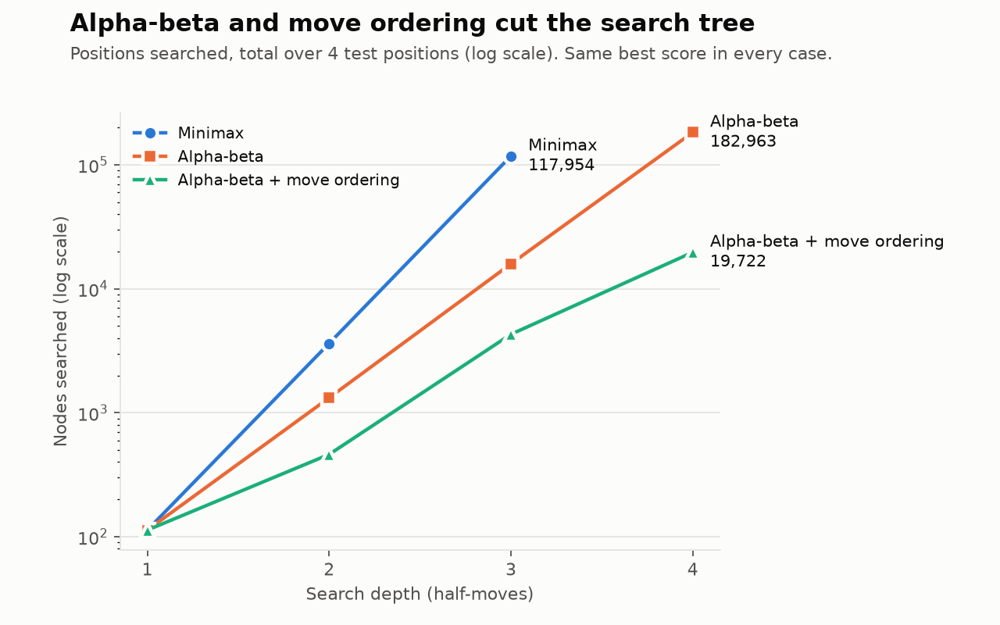
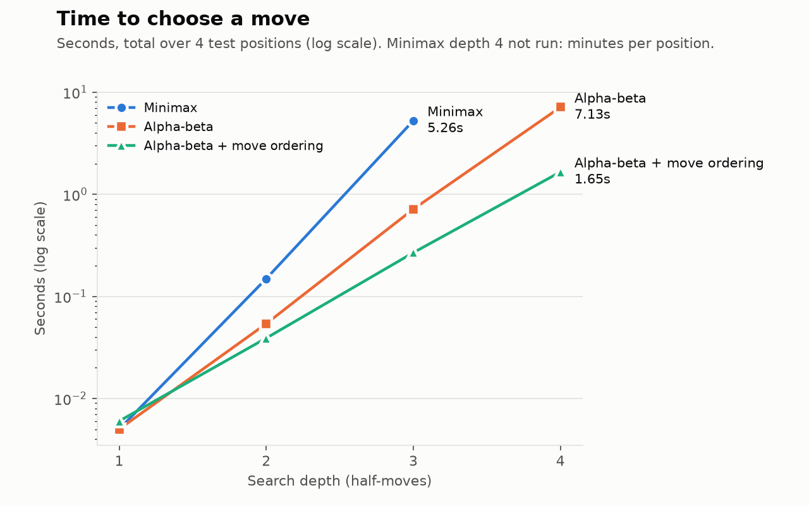
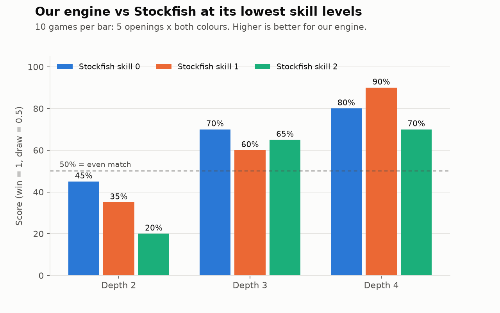

# AI Chess Assistant for Beginner Players

**Course project report: Artificial Intelligence**

Group members: ____________________ (fill in names and roll numbers)

Repository: https://github.com/astrilo-monk/ai-project-clg

---

## 1. Introduction

We built an AI chess assistant that plays chess against a beginner, judges every move the beginner makes, and explains mistakes in plain English. The system combines **adversarial search** (minimax with alpha-beta pruning, move ordering and quiescence search), a **heuristic evaluation function**, and a **rule-based expert system** that turns the engine's numbers into explanations. Alpha-beta pruning with move ordering searched **96.4% fewer positions** than plain minimax at depth 3 while making identical decisions. Against Stockfish 16 at its three lowest skill levels (90 games), the engine's score rose with search depth, from 33% at depth 2 to 65% at depth 3 and 80% at depth 4.

### 1.1 Problem Statement

Beginner chess players lose most games to simple tactical errors: leaving a piece undefended, missing a free capture, or walking into checkmate. After the game they usually cannot tell which move was the mistake, what they should have played instead, or why.

Existing tools do not solve this. Strong engines such as Stockfish play far above human level, but they communicate through a number ("-3.2") and long move sequences. Human coaches can explain, but they are expensive and not always available.

**The problem:** build an intelligent agent that (1) plays chess at an adjustable, beginner-appropriate level and (2) detects the user's mistakes and explains them in language a beginner understands.

### 1.2 Importance of the Problem

- **Learning needs feedback, not just results.** A beginner who loses without knowing why repeats the same mistake. Immediate, specific feedback ("your knight on f3 is undefended") is what turns a lost game into a lesson.
- **Access to coaching is unequal.** A tool that explains mistakes for free makes structured feedback available to anyone with a computer.
- **It is a clear test of explainable AI.** Chess engines are a classic case of an AI that is strong but cannot explain itself. Making a game-playing AI justify its judgements in human terms is a small, measurable version of a problem that matters across AI.
- **It is a classic AI benchmark.** Chess has been a standard testbed for search and knowledge representation since Shannon (1950), so the results can be compared with well-known theory.

---

## 2. Objectives

1. Formulate chess as an AI problem and identify the knowledge an agent needs to play it.
2. Build a chess-playing agent **from scratch** using classical adversarial search (minimax, alpha-beta pruning, move ordering, quiescence search) and a heuristic evaluation function.
3. Let the user play against it at four difficulty levels.
4. Automatically classify every user move as Best, Good, Inaccuracy, Mistake or Blunder.
5. Explain mistakes in plain English and suggest a better move with the reason it is better.
6. Evaluate the system experimentally: search efficiency, playing strength, and correctness.

---

## 3. AI Problem Formulation

Chess is formulated as a **two-player, zero-sum, deterministic game of perfect information**, solved by **adversarial search**.

| Component | Definition in this project |
|---|---|
| Initial state | The standard starting position, White to move |
| State | A full board position: piece placement, side to move, castling rights, en passant square, halfmove clock |
| PLAYER(s) | The side to move in state s |
| ACTIONS(s) | All legal moves in s (about 35 on average) |
| RESULT(s, a) | The position after move a is played in s |
| TERMINAL(s) | True on checkmate, stalemate, insufficient material, threefold repetition or the 50-move rule |
| UTILITY(s) | +1 if White wins, 0 for a draw, -1 if Black wins. Implemented as ±100000 minus the distance to mate, so faster wins score higher |
| EVAL(s) | Heuristic estimate of a non-terminal position, in centipawns (100 = one pawn) from White's point of view, used when the search reaches its depth limit |

**Why adversarial search and not ordinary search?** In ordinary search (for example A* on a map) the agent controls every action. In chess every other move is chosen by an opponent who is trying to make us lose, so a line that looks good is worthless if the opponent can refute it. The agent must assume the opponent plays its best reply, which is exactly what minimax models: White maximises the score, Black minimises it.

### 3.1 Environment and Intelligent Agent

**PEAS description**

| | Description |
|---|---|
| Performance measure | Win rate against reference opponents; positions searched and time per move; correctness of move classification; clarity of explanations |
| Environment | An 8x8 board, the rules of chess, and a human opponent (the beginner) |
| Actuators | Playing a move; displaying move grades, explanations, hints and arrows on the board |
| Sensors | The current board position and the move the user just played |

**Properties of the environment**

| Property | Value | Reason |
|---|---|---|
| Observable | Fully observable | Both players see the whole board |
| Agents | Multi-agent, competitive | Two players with opposite goals |
| Deterministic | Deterministic | A move always produces the same next position |
| Episodic / Sequential | Sequential | Every move affects all future positions |
| Static / Dynamic | Static | The board does not change while the agent thinks |
| Discrete / Continuous | Discrete | Finite squares, pieces and moves |
| Known / Unknown | Known | The rules are fully specified |

**The intelligent agent.** The system contains two cooperating agents:

- **The playing agent** is a **utility-based agent**. It looks ahead through possible move sequences, scores the resulting positions with its evaluation function, and chooses the move with the highest expected utility assuming best play by the opponent.
- **The coaching agent** is a **knowledge-based agent**. It observes the user's move, asks the playing agent for the best alternative and its value, and applies a rule base to decide what went wrong and how to describe it.

---

## 4. Types of Knowledge Required

| Knowledge type | What the agent must know | Example |
|---|---|---|
| **Declarative** (facts) | The rules of chess; the relative value of each piece | A bishop moves diagonally; a rook is worth about 5 pawns |
| **Heuristic** (rules of thumb) | Positional principles that predict who is better before the game ends | Knights are strong in the center; castle early; activate the king in the endgame |
| **Procedural** (how to) | How to look ahead, which branches to skip, and which moves to try first | Search captures before quiet moves |
| **Expert / meta-knowledge** (teaching) | What beginner mistakes look like and how to explain them | "A piece attacked by a cheaper piece is in danger even if defended" |

### 4.1 Knowledge Representation

| Knowledge | Representation | Where in code |
|---|---|---|
| Rules of chess | Board model and legal move generator (the environment) | python-chess library |
| Board state | `chess.Board` object; written as a FEN text string for tests and storage | python-chess |
| Piece values | A constant table: Pawn 100, Knight 320, Bishop 330, Rook 500, Queen 900 | `engine/evaluate.py` |
| Positional principles | **Piece-square tables**: one 64-entry array per piece type giving a bonus or penalty for each square (for example a knight gets +20 in the center and -50 in a corner); separate middlegame and endgame tables for the king | `engine/evaluate.py` |
| Look-ahead | A game tree explored implicitly by recursive search; scores backed up from the leaves | `engine/search.py` |
| Move priorities | A scoring function (MVV-LVA) used to sort moves | `engine/ordering.py` |
| Teaching knowledge | **If-then production rules** over board facts and engine scores | `assistant/explain.py` |
| Move quality scale | Thresholds on centipawn loss (50 / 100 / 200) | `assistant/blunder.py` |

---

## 5. AI Techniques Selected

| Technique | Purpose in the system |
|---|---|
| Minimax search | Choose the move that is best assuming the opponent also plays its best |
| Alpha-beta pruning | Skip branches that cannot change the decision |
| Heuristic evaluation function | Score positions at the depth limit |
| Move ordering (MVV-LVA) | Search the most promising moves first, so alpha-beta prunes more |
| Quiescence search | Continue searching captures past the depth limit to reduce the horizon effect |
| Centipawn-loss move review | Measure how much worse the user's move was than the best move |
| Rule-based expert system | Turn engine output into plain-English explanations |
| Null-move threat detection | Find what the opponent is threatening, to explain defensive moves |

### 5.1 Justification for AI

1. **The search space is far too large for brute force.** With about 35 legal moves per position and games of about 80 half-moves, chess has around 10^120 possible games (Shannon, 1950). The agent must search a limited depth and **estimate** the rest with heuristic knowledge.
2. **There is an intelligent adversary.** A fixed set of if-then rules for choosing moves cannot anticipate every plan an opponent might try. The agent has to **reason about the opponent's best replies**, which is adversarial search.
3. **Positions must be judged before the game ends.** Two positions with equal material can be very different. Judging them requires **encoded domain knowledge** (the evaluation function).
4. **Explaining requires reasoning, not only playing.** To say *why* a move is bad, the system compares what happened with what the best move would have achieved and matches the difference against known mistake patterns. This is **knowledge-based reasoning** on top of search.

A conventional (non-AI) program could enforce the rules and draw the board, but it could neither choose good moves nor explain bad ones.

### 5.2 System Architecture

The system has four layers. Each layer only uses the layers below it.

```
+------------------------------------------------------------------+
| Layer 4: User interface             app.py (Streamlit)           |
|   board, move input, coach panel, hints, take back, difficulty   |
+------------------------------------------------------------------+
| Layer 3: Beginner assistant (coaching agent)                     |
|   blunder.py: judge a move   explain.py: explain it              |
|   hints.py: suggest a move                                       |
+------------------------------------------------------------------+
| Layer 2: Engine (playing agent)                                  |
|   search.py: minimax, alpha-beta, quiescence                     |
|   ordering.py: MVV-LVA      evaluate.py: material + tables       |
+------------------------------------------------------------------+
| Layer 1: Rules of chess (environment)       python-chess library |
+------------------------------------------------------------------+
```

**What happens when the user plays a move:**

1. The user picks a move in the interface.
2. The coach calls the engine twice: once for the best move in the position, once for the value of the user's move.
3. The difference (centipawn loss) gives the label: Best, Good, Inaccuracy, Mistake or Blunder.
4. The expert system matches the situation against its rules and produces the explanation, the better move with its reason, and any opening tips.
5. The move is played, and the engine replies at the chosen difficulty.
6. The interface shows the new board, the coach's feedback, and the move history coloured by move quality.

**Difficulty levels**

| Level | Search depth | Quiescence |
|---|---|---|
| Easy | 1 | Off |
| Medium | 2 | On |
| Hard | 3 | On |
| Expert | 4 | On |

The coach always reviews at depth 3, so the user's moves are judged the same way at every difficulty.

**Implementation:** Python 3.10+, python-chess (rules and board drawing), Streamlit (web interface), matplotlib (charts), Stockfish 16 (benchmark opponent only, never used to choose moves). About 2,000 lines of Python including tests.

---

## 6. Algorithms

### 6.1 Minimax

```
function MINIMAX(s, depth):
    if TERMINAL(s): return UTILITY(s)
    if depth = 0:   return EVAL(s)
    if PLAYER(s) = White:
        return max over a in ACTIONS(s) of MINIMAX(RESULT(s, a), depth - 1)
    else:
        return min over a in ACTIONS(s) of MINIMAX(RESULT(s, a), depth - 1)
```

Minimax is optimal against a perfect opponent within its depth limit, but it visits every node, so its cost grows as b^d (about 35^d).

### 6.2 Alpha-beta pruning

```
function ALPHABETA(s, depth, alpha, beta):
    if TERMINAL(s): return UTILITY(s)
    if depth = 0:   return QUIESCENCE(s, alpha, beta)
    if PLAYER(s) = White:
        best = -infinity
        for a in ORDERED-ACTIONS(s):
            best  = max(best, ALPHABETA(RESULT(s, a), depth - 1, alpha, beta))
            alpha = max(alpha, best)
            if alpha >= beta: break        # Black will never allow this line
        return best
    else:  (symmetric, with min and beta)
```

**alpha** is the best score White is already guaranteed elsewhere in the tree; **beta** is the best score Black is already guaranteed. When alpha ≥ beta, the opponent already has a better option elsewhere, so the remaining moves at this node cannot affect the decision and are skipped. The result is provably identical to minimax (Knuth and Moore, 1975). With perfect move ordering the cost falls from b^d to about b^(d/2).

### 6.3 Evaluation function

```
EVAL(s) = sum over White pieces p of (VALUE[p] + TABLE[p][square of p])
        - sum over Black pieces p of (VALUE[p] + TABLE[p][mirrored square of p])
```

The king uses its endgame table when there are no queens, or when each side with a queen has no rooks and at most one minor piece.

### 6.4 Move ordering (MVV-LVA)

```
score(move) = 10 × VALUE[captured piece] − VALUE[moving piece]    if a capture
            + bonus                                                if a promotion
            + bonus                                                if it gives check
search moves in decreasing order of score
```

Pawn takes queen (8,900) is searched before queen takes pawn (100). Earlier strong moves produce earlier cut-offs.

### 6.5 Quiescence search

```
function QUIESCENCE(s, alpha, beta):          (shown for White; Black is symmetric)
    stand_pat = EVAL(s)
    if stand_pat >= beta: return stand_pat
    alpha = max(alpha, stand_pat)
    for each capture a in ORDERED-CAPTURES(s):
        score = QUIESCENCE(RESULT(s, a), alpha, beta)
        if score >= beta: return score
        alpha = max(alpha, score)
    return alpha
```

This removes the **horizon effect**: without it, a depth-2 search may think "queen takes pawn" wins a pawn because the recapture is just beyond its horizon. Extra capture depth is capped at 8 half-moves.

### 6.6 Move review by centipawn loss

```
function REVIEW(s, played):
    best   = SEARCH(s, depth 3)                    # best move and its value
    after  = RESULT(s, played)
    value  = SEARCH(after, depth 2)                # the same subtree, one move already played
    loss   = max(0, value(best) − value(played))   # from the player's point of view
    label  = Best        if played = best move
             Good        if loss < 50
             Inaccuracy  if loss < 100
             Mistake     if loss < 200
             Blunder     otherwise
```

### 6.7 Explanation rules (expert system)

Rules fire only on moves already labelled Inaccuracy, Mistake or Blunder, so the engine decides **if** a move is bad and the rules explain **why**:

| Rule | IF | THEN say |
|---|---|---|
| Walking into mate | the played move's value is a forced mate for the opponent | "This move walks into checkmate: your opponent plays Qh4#." |
| Missed mate | the best move's value was a forced mate for the player | "You missed a checkmate in one move, starting with Ra8#." |
| Moved piece hangs | the opponent's best reply captures the piece just moved, and it is undefended or attacked by a cheaper piece | "You moved your bishop to a6, where it is undefended and can be captured for free." |
| Defender moved away | the reply captures a piece that was safe before the move | "Your pawn on e5 is no longer protected after this move." |
| Missed capture | the best move captured an undefended piece | "You missed a free queen on d5 (Nxd5)." |
| Opening tips | a queen move, king move or edge knight move in the first 10 moves | "You brought your queen out early. Develop your knights and bishops first." |

### 6.8 Null-move threat detection

```
function THREATS(s):
    pass the turn without moving (a "null move")
    return every opponent move that would now give checkmate
```

If a move removes such a threat, the coach explains it: "g6 stops your opponent's checkmate threat (Qxf7#)."

---

## 7. Comparison of AI Techniques

### 7.1 Search algorithms compared experimentally

Total positions searched over four test positions (start, Italian opening, middlegame, endgame), with quiescence off so that every variant searches the same tree:

| Depth | Minimax | Alpha-beta | Alpha-beta + move ordering | Reduction vs minimax |
|---|---|---|---|---|
| 1 | 113 | 113 | 113 | 0% |
| 2 | 3,627 | 1,320 | 461 | 87.3% |
| 3 | 117,954 | 15,895 | 4,296 | **96.4%** |
| 4 | not run (minutes per position) | 182,963 | 19,722 | ordering vs plain alpha-beta: **89.2%** |





All three variants returned **exactly the same best score** in every case (checked by an automated test). The growth rates match theory: each extra ply multiplies minimax's work by about the branching factor (32x from depth 2 to 3), while alpha-beta with ordering grows by about 9x and 4.6x per ply, consistent with the b^(d/2) best case.

### 7.2 Effect of search depth on playing strength

Our engine played Stockfish 16 at Skill Levels 0, 1 and 2 (out of 20; 0.05 s per move, 1 thread). Each pairing is 10 games: 5 openings, each played once with each colour, because our engine is deterministic and would otherwise repeat the same game. Score = wins + 0.5 × draws.

| Our depth | vs Skill 0 | vs Skill 1 | vs Skill 2 | Total (30 games) | W / D / L |
|---|---|---|---|---|---|
| 2 (Medium) | 45% | 35% | 20% | **33%** | 7 / 6 / 17 |
| 3 (Hard) | 70% | 60% | 65% | **65%** | 17 / 5 / 8 |
| 4 (Expert) | 80% | 90% | 70% | **80%** | 21 / 6 / 3 |



- **Search depth is what makes the engine stronger** (33% → 65% → 80%). Alpha-beta and move ordering (section 7.1) are what make depth 4 affordable, at about 2 seconds per move.
- **Differences between skill levels are within noise.** With 10 games per bar, one game moves a score by 5 to 10 points. The depth trend holds at every skill level, so it is the reliable conclusion.
- **16 of the 17 draws were threefold repetitions**, showing that the engine has no endgame plan (see Limitations).
- These are deliberately weakened Stockfish settings, so the results show **relative** improvement, not an absolute rating.

All 90 games, with full move lists, are in `docs/results/benchmark_games.csv`.

### 7.3 Alternative techniques considered

| Technique | Strengths | Weaknesses for this project | Decision |
|---|---|---|---|
| **Minimax + alpha-beta** | Exact for two-player zero-sum games; deterministic; easy to explain and test; fast enough in Python at depth 3 to 4 | Needs a hand-written evaluation; limited depth in Python | **Chosen** for move selection |
| **Monte Carlo Tree Search** | Strong when the branching factor is huge (for example Go); needs no evaluation function | Needs thousands of random playouts per move, slow in Python; random playouts are weak in chess tactics; harder to explain | Rejected |
| **Reinforcement learning / neural networks** (AlphaZero style) | Learns its own evaluation; very strong | Needs millions of self-play games and GPU training; a black box that cannot explain itself | Rejected; listed as future work for the evaluation only |
| **Using Stockfish directly** | Extremely strong | Contains no AI of our own; the project would be a wrapper | Used **only** as a benchmark opponent |
| **Rule-based expert system** for explanations | Every sentence traceable to a rule and a board fact; predictable; needs no data | Covers only the patterns written as rules | **Chosen** for explanations |
| **Machine learning / language model** for explanations | Could produce varied, fluent text | Needs labelled explanation data that does not exist freely; can state wrong reasons confidently, which is unacceptable in a teaching tool | Rejected |

### 7.4 Verification

22 automated tests all pass. They show, among other things, that alpha-beta (with and without ordering) returns exactly the minimax score; that the engine finds mate in 1 for both colours and mate in 2; that it captures a free queen and refuses a pawn that would cost its queen; and that the coach correctly identifies the Fool's Mate (...Qh4#), a missed back-rank mate, hanging pieces with the right squares, and the ...g6 defence against the Scholar's Mate threat. Reviewing one move takes 0.02 to 1.1 seconds.

---

## 8. Limitations

1. **Depth-limited judgement.** The coach looks 3 half-moves ahead, so it can misjudge long-term sacrifices. For example, it labels the sound 4.Ng5 in the Two Knights Defence an inaccuracy.
2. **Simple evaluation.** The engine knows material and piece placement, but not king safety, pawn structure or piece mobility.
3. **Explanations cover common patterns only.** Forks, pins and skewers are not yet named; in those cases the coach falls back to describing the material the opponent wins.
4. **Speed.** Pure Python limits practical search to depth 4.
5. **No opening or endgame knowledge.** The engine calculates from move 1 and can shuffle pieces in won endgames; 16 of the 17 benchmark draws were threefold repetitions.

---

## 9. Future Scope

- A transposition table and iterative deepening, for deeper and faster search
- Detecting and naming tactics: forks, pins, skewers and discovered attacks
- A richer evaluation (king safety, pawn structure, mobility), possibly tuned or learned from games
- An opening book for variety and endgame tablebases for perfect endgame play
- Importing the user's own games (PGN files) so that past games can be reviewed

---

## 10. Conclusion

We formulated chess as an adversarial search problem and built a complete chess-playing agent from scratch. Experiments showed that alpha-beta pruning with move ordering keeps minimax's decisions while removing over 96% of the search at depth 3, and that the depth this makes affordable translates directly into playing strength: from 33% to 80% against Stockfish's weakest settings as the depth rose from 2 to 4. On top of the engine, a rule-based expert system turns numerical evaluations into specific, checkable explanations for beginners. The project shows search, heuristic knowledge representation and expert-system reasoning working together in an agent that teaches rather than only plays.

---

## 11. References

1. Russell, S. and Norvig, P. (2020). *Artificial Intelligence: A Modern Approach*, 4th ed. Pearson. Chapter 5: Adversarial Search and Games.
2. Shannon, C. E. (1950). Programming a Computer for Playing Chess. *Philosophical Magazine*, 41(314), 256–275.
3. Knuth, D. E. and Moore, R. W. (1975). An Analysis of Alpha-Beta Pruning. *Artificial Intelligence*, 6(4), 293–326.
4. Michniewski, T. Simplified Evaluation Function. Chess Programming Wiki.
5. python-chess documentation. https://python-chess.readthedocs.io
6. Stockfish. https://stockfishchess.org

---

## Appendix A: Reproducing the Results

```bash
pip install -r requirements.txt
streamlit run app.py               # the application
python -m tests.test_engine        # 9 tests
python -m tests.test_assistant     # 13 tests
python -m tests.compare_search     # section 7.1 (about 20 seconds)
python -m tests.benchmark          # section 7.2 (needs Stockfish, 30 to 60 minutes)
python -m tests.make_charts        # charts in docs/results/
```

## Appendix B: Tools Used

python-chess, Streamlit, matplotlib, Stockfish 16 (benchmark only), Git and GitHub. An AI coding assistant (Claude) was used during implementation; the commit history records this.
